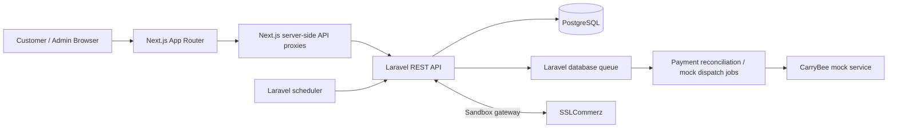

# ShopSphere — Engineering Notes

> **Technical evaluation | Laravel 13 · PHP 8.4 · PostgreSQL 17 · Next.js 16 · TypeScript · Tailwind CSS**  
> These notes explain the implemented decisions, their trade-offs, and the work required before production. Read [README.md](README.md) for installation and API usage.

## 1. Scope and current status

ShopSphere is a **single-vendor e-commerce assessment** with a public storefront and authenticated administrator interface. The application covers product management, stock adjustments, cart, checkout, SSLCommerz sandbox payment initiation/verification, reconciliation, and simulated CarryBee delivery dispatch. It includes an administrative dashboard with business metrics, orders, payments, inventory movement history, delivery records, and exceptional-payment review.

**Validated locally (17 October 2026):** Laravel **104 passing tests / 415 assertions**, and a successful Next.js TypeScript check and production build. A manual sandbox payment confirmed an order (`confirmed`), payment (`paid`), and creation of a mock consignment. These results demonstrate the tested local configuration; they are **not** a claim of production-readiness or a live CarryBee connection.

## 2. Architecture and separation of concerns



- **Laravel** owns validation, authorization, pricing, inventory operations, payment state changes, and business integrity. Do not trust totals, payment outcomes, or stock calculated only in a browser.
- **Next.js** owns customer/admin presentation. For admin operations, its server-side proxy reads a Sanctum token from an HttpOnly cookie and calls the Laravel API; client components do not receive the Bearer token.
- **PostgreSQL** persists orders, items, inventory, movements, payments, and deliveries; critical transitions use database transactions and row locking where implemented.
- **Laravel events/listeners and queued jobs** decouple payment-driven fulfillment and reconciliation from customer-facing requests.
- **The scheduler** handles time-dependent work, including expiry of abandoned reserved orders.

This is a **modular monolith + separate Next.js frontend**, not a distributed microservice system. It favors easier debugging and transactional consistency for an assessment-scale application.

## 3. Database design and integrity

### 3.1 Main entities

| Entity | Responsibility / relationship |
| --- | --- |
| `users` | Admin identity; admin-only permissions and Sanctum tokens |
| `products` | Product catalog, unique SKU, price, activation status; soft deletion |
| `inventories` | Product-specific on-hand/availability data |
| `inventory_movements` | Traceable adjustments with signed quantity changes and reasons |
| `orders` | Customer/shipping snapshot, totals, order/payment/delivery states, reservation expiry |
| `order_items` | Purchased item quantities and price snapshots |
| `payments` | Gateway transaction IDs, attempts, verification/reconciliation state, timestamps and metadata |
| `deliveries` | Fulfillment status, mock consignment/tracking IDs, retry information |
| `personal_access_tokens` | Sanctum admin API token storage |

The main relationships are **Product → Inventory (one-to-one)**, **Order → Items (one-to-many)**, **Order → Payments (one-to-many)**, **Order → Delivery (one-to-one)**, and **Payment → Order (many-to-one)**.

### 3.2 Consistency choices

- A newly created product receives an inventory record with **quantity 0**. Product creation and inventory initialization are performed within the same transaction.
- Product SKU uniqueness and order relationships are enforced by application validation and appropriate database constraints; review the migrations for exact indexes/foreign keys.
- Checkout recomputes product prices and order totals on the server rather than accepting price fields from the client.
- The checkout flow reserves stock for an order and assigns a **30-minute expiry**. Cancellation and expiry paths must release/reconcile reservations without driving stock negative.
- Stock changes go through an inventory service, with an inventory movement audit entry instead of arbitrary frontend-controlled quantity writes.
- Stock-out must respect **available stock**, including quantities reserved for orders. Concurrency-sensitive operations should lock the relevant rows and perform changes atomically.

**Important distinction:** On-hand, reserved, and available stock are not interchangeable. The UI may show the reserved count as unavailable (`—`) if that field is not returned by a particular API response. It should not invent the value.

## 4. Order and payment lifecycle

### 4.1 Checkout

1. Customer submits contact/shipping details and product IDs/quantities.
2. Laravel validates input, reads current product records/prices, checks inventory, calculates totals, creates the order and items, and reserves stock within a controlled transaction.
3. The new order starts as **pending** with an expiration window; the checkout response includes a one-time **64-character payment access token** (only its SHA-256 hash is stored server-side).
4. Customer initiates an SSLCommerz sandbox transaction using the order ID and payment access token.
5. Laravel calls the gateway and returns its hosted HTTPS payment URL. Actual card/OTP handling stays on SSLCommerz-hosted pages.

### 4.2 Verification and callbacks

- **Gateway redirect ≠ verified payment.** The `success` callback confirms through the payment confirmation service before updating payment/order states. The browser is then redirected to a ShopSphere result page.
- **IPN** is handled server-to-server and returns JSON. JSON-request compatibility is preserved for callback tests; browser requests receive redirects where appropriate.
- **Duplicate success/IPN:** Confirmation logic is intended to be idempotent, so repeat notifications should not cause duplicate confirmation/stock consumption or duplicate dispatch.
- **Failure/cancellation notifications:** The system queues reconciliation for unresolved attempts rather than assuming an unverified final failure and immediately releasing stock.
- **Gateway uncertainty:** If initiation or verification cannot be conclusively resolved, the transaction may remain `pending`/`processing`; background reconciliation is required.
- **Customer result page:** Queries the Laravel payment-status endpoint with the matching order ID and per-order access token. The cart is cleared **only after the backend reports `paid`**, not merely because a query string contains `success`.

One locally verified sandbox transaction resulted in order **#112** being `confirmed`, payment **#78** being `paid`, and delivery status `created`. This example is test evidence, **not seed data or a guaranteed ID in another environment**.

### 4.3 Late success and refunds

The administrator can inspect specifically flagged `late_successful_payment` cases and record `investigating` or `refund_required`, with a note and reviewer metadata. These actions **do not refund a customer** and do not convert an unresolved attempt into a verified success. Actual refund initiation, provider confirmation, accounting adjustments and reconciliation require additional integration.

## 5. Delivery integration and asynchronous work

The app uses an order-paid event/listener path to queue `DispatchCarryBeeDelivery` after verified confirmation. In the assessed environment, **CarryBee is a mock adapter**, generating identifiers such as `MOCK-CB-...` and `MOCK-TRK-...`; no live delivery is booked.

- Delivery work executes outside the immediate checkout request to avoid making the customer wait for a courier integration.
- Admins can view delivery lists/details and retry **only** eligible failed deliveries for a confirmed, paid order without an existing consignment ID, and only when mock mode is enabled.
- Retry sets the delivery back to a queued state and dispatches a job after transaction commit. A `202 Accepted` response means **queued**, not successfully delivered.
- Real CarryBee work would require verified API documentation/credentials, auth, HTTP timeouts, idempotency keys, provider error mapping, webhook verification, and periodic status synchronization.

## 6. Queue, scheduler and caching strategy

| Concern | Current implementation | Trade-off / follow-up |
| --- | --- | --- |
| Queue backend | Laravel **database queue** | Easier local setup; lower throughput than a well-operated Redis queue |
| Queued work | Mock delivery dispatch and payment reconciliation | Must run a worker; retries/failures need operational visibility |
| Scheduler | Reservation expiry and other time-based maintenance | Must run continuously or through a real cron service |
| Product fetch | Next.js catalog fetch revalidation (~60 seconds) | Public updates are eventually visible; not immediate cache invalidation |
| Admin reads | No-store server requests; paginated endpoints | Favors correctness over caching; larger installs need measured tuning |
| Redis | **Not established as an active integration** in the verified configuration | Assessment specification mentions Redis/caching; document this gap rather than claiming completion |

Local worker and scheduler:

```powershell
cd backend
php artisan queue:work database --queue=default --tries=3 --timeout=90 -v
```

In another terminal:

```powershell
cd backend
php artisan schedule:work
```

For production, use a process supervisor/worker management system, alerts for failed jobs, a durable scheduler, and measured Redis adoption for cache and/or queue if warranted. A cache invalidation plan must account for product and inventory changes.

## 7. Performance decisions

- **Pagination** limits responses for admin products, orders, payments, deliveries, movement history, and payment reviews. The public product API supports pagination; the current homepage displays up to 100 products, without customer-facing page controls.
- **Eager loading** is used for key list/detail relationships such as payment→order, delivery→order, and product→inventory, reducing avoidable N+1 queries.
- **Selective relationship fields** reduce unnecessary payloads in applicable endpoints.
- **Transactions and row locks** protect critical inventory/payment/delivery state transitions; correctness is prioritized over premature optimizations.
- **Background jobs** move slow/retryable provider work out of the customer request where possible.
- **Database indexes** should be checked against the actual migrations and query plans. In particular, searchable SKU, order number, transaction ID and frequently filtered foreign keys/status fields warrant evaluation; PostgreSQL `ILIKE '%term%'` may require trigram indexing for larger datasets.

No independent load test or production-scale benchmark has been completed; scalability statements are architectural expectations, not measured results.

## 8. Error handling and recovery

| Scenario | Current handling / principle |
| --- | --- |
| Invalid product or checkout request | Laravel validation errors (`422`) with actionable messages |
| Invalid admin login / insufficient access | Consistent credential failure and Sanctum-protected admin routes |
| Out-of-stock or stock-out beyond availability | Inventory validation/service rejects unsafe adjustment |
| Failed gateway initialization / uncertain response | Avoid treating an unknown outcome as definitively failed; reconcile |
| Repeated gateway callback | Idempotent confirmation path, covered by backend tests |
| Expired/abandoned order | Scheduled expiry and stock reservation cleanup subject to payment state |
| Mock courier failure | Delivery records track failure; eligible admin retry queues work |
| Late successful payment | Separate review queue and saved administrative decision, without claiming a refund |
| Downstream API not reachable | API surfaces controlled errors; frontend includes loading/error/empty states |

**Potential recovery gap:** The checkout access token is temporarily kept in browser `sessionStorage` for redirect-back verification. A lost tab/session can interrupt the customer confirmation experience; a production version needs a safe token-based recovery mechanism without exposing order PII. Pending statuses are not continuously polled by the current result page. Payment-request timeout ambiguity also needs a robust checkout idempotency strategy to prevent accidental duplicate orders.

## 9. Security and authorization

- Laravel Sanctum secures admin APIs, with a separate admin authorization layer and administrator checks in request validation.
- Next.js holds the Laravel admin token in a **server-set HttpOnly cookie**; frontend fetches admin data via a Next.js server-side proxy.
- Several mutating Next.js proxy routes enforce same-origin requests. **Audit all state-changing endpoints consistently** for CSRF/origin protections; a cookie alone is not a complete security guarantee.
- Admin login is rate limited; other sensitive endpoints also use Laravel throttling where configured.
- Per-order payment-status access requires a strong random token; Laravel stores its SHA-256 hash rather than the plaintext.
- Untrusted browser redirect parameters cannot establish a paid status; server-side verification is authoritative.
- `.env`, `.env.local`, merchant keys, DB credentials and personal access tokens must never be committed.
- Hosted checkout keeps card and OTP capture with SSLCommerz. Never collect or log live card credentials in ShopSphere.

Production hardening should add consistent CSRF strategy, short-lived/revocable sessions, secure cookie and reverse-proxy configuration, CSP/XSS defenses (especially with `sessionStorage`), least-privilege database credentials, secret rotation, webhook authenticity checks, log redaction, and data-retention rules.

## 10. Testing and validation

**Most recent shared local outcomes (2026-10-17):**

```text
Backend:   104 tests passed, 415 assertions
Frontend:  TypeScript check passed; Next.js 16.4.2 production build passed
```

Commands:

```powershell
cd backend
php artisan test
```

```powershell
cd frontend
npx tsc --noEmit
npm run build
```

Manual workflows exercised during development include admin login/logout, product CRUD, stock in/out and movements, customer product search, sandbox card payment and successful callback, authoritative payment status, and mock delivery creation. A successful build/test run is not equivalent to end-to-end production or security certification.

**Suggested additional tests before production:** concurrent checkout/stock adjustments; payment initiation timeouts; gateway malformed/replayed callbacks; cancellation/expiry races; duplicate delivery job execution; cookie/CSRF attacks; customer result-page session loss; low bandwidth/375px screen; worker outage/recovery; actual provider failures.

## 11. Assessment trade-offs and gaps

| Requested or desirable capability | Current situation |
| --- | --- |
| SSLCommerz integration | **Sandbox implemented and manually exercised**; production credentials/settlement not validated |
| CarryBee API integration | **Mock only**; live provider API is not implemented |
| Redis/caching | Not established as a running Redis deployment; Next.js revalidation used for catalog |
| Jobs/events/listeners/scheduler | Implemented in backend; require operating queue worker and scheduler |
| Admin product/inventory/orders/payments/delivery views | Implemented; some backend-only actions are not exposed in UI |
| Frontend TanStack Query and shadcn/ui | Listed in evaluation spec, **not verified as integrated** in current frontend |
| Customer pagination | Backend supports it; homepage currently fetches at most 100 products |
| Customer order history / persistent recovery | No complete customer account/order-history flow established |
| Refund execution | **Not implemented**; review metadata only |
| Real-time delivery tracking | Not implemented; mock reference IDs |
| Observability/CI | Production monitoring, dashboards for failures, and CI verification not established |

These are disclosed intentionally so an evaluator can distinguish implemented functionality from design intent.

## 12. Production improvement plan

**P0 — correctness and security**

1. Audit full payment gateway callback contract and webhook authenticity; add production-grade idempotency and replay protection.
2. Add checkout idempotency keys, recoverable order status, and robust handling for uncertain initiation/timeouts.
3. Harden session/cookie and CSRF controls, secrets management, customer data exposure and retention.
4. Implement live CarryBee adapter with documented authentication and idempotent dispatch; add provider status sync.
5. Design refund workflow with provider acknowledgments, operator permissions and complete audit trails.

**P1 — reliability and user experience**

1. Add retry/backoff, dead-letter/failed-job monitoring, alerts and worker health checks.
2. Provide a safe customer order-status/recovery flow and pending-payment polling with backoff.
3. Add customer-facing pagination and explicit catalog cache invalidation after product/stock changes.
4. Verify mobile behavior on a 375px device and accessibility/keyboard navigation in dialog flows.
5. Add automated CI for PHP tests, TypeScript, builds, security scanning and migration smoke tests.

**P2 — scale and operations**

1. Benchmark with realistic datasets; profile PostgreSQL queries and add indexes based on `EXPLAIN ANALYZE`.
2. Evaluate Redis for rate limiting/cache/queues, after measuring workload and operational costs.
3. Add structured metrics, tracing, slow-query monitoring and payment/delivery operations dashboards.
4. Introduce role-specific permissions and more comprehensive BI reporting as usage grows.

---

### Engineering principle

**Correct inventory and verified payment state take priority over optimistic UI or quick state transitions.** When an external provider's answer is uncertain, the system should preserve evidence, avoid irreversible assumptions, and expose a clear operational recovery path.

*These notes describe the implementation and limitations reported during development. For exact deployment environment variables and runnable commands, refer to [README.md](README.md) and the repository's configuration files.*
