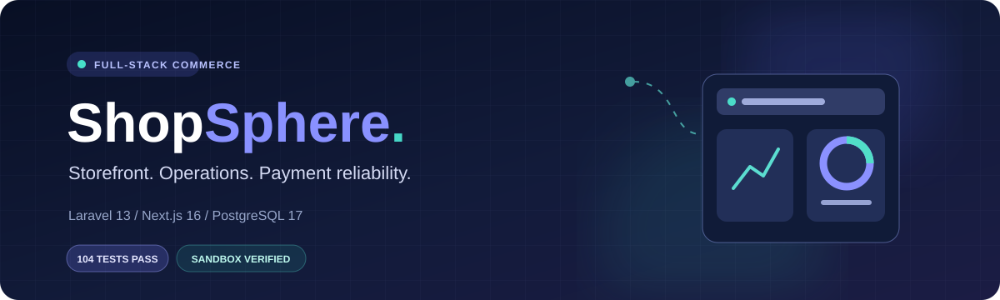
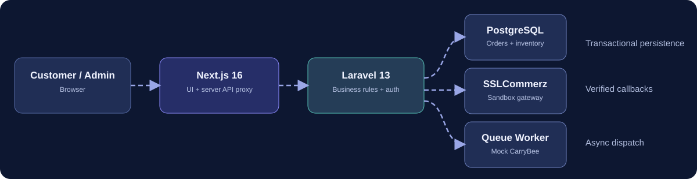
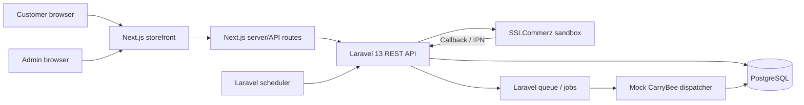
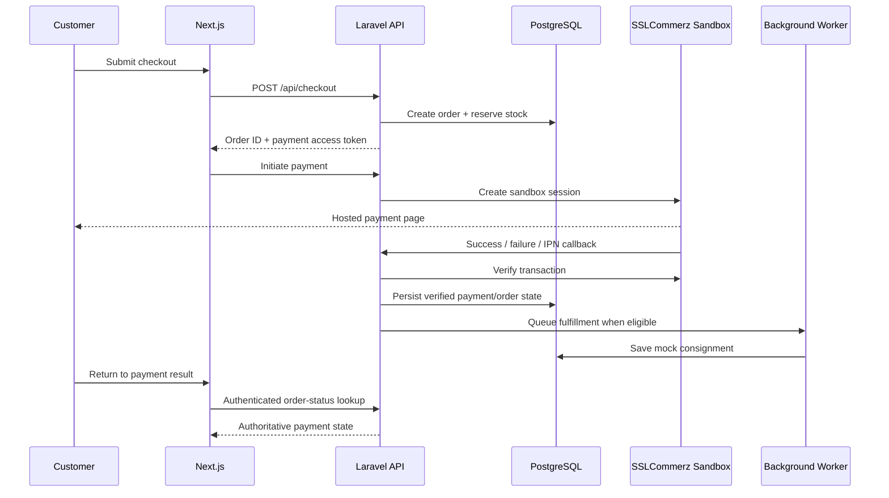

<div align="center" id="top">



<br/>

<a href="https://laravel.com/"></a>
<a href="https://nextjs.org/"></a>
<a href="https://www.postgresql.org/"></a>
<a href="https://www.typescriptlang.org/"></a>


<p><b>Single-vendor commerce meets reliable backend operations.</b></p>

<p>
<a href="#-overview"><b>Overview</b></a> ·
<a href="#-features"><b>Features</b></a> ·
<a href="#-architecture"><b>Architecture</b></a> ·
<a href="#-getting-started"><b>Quick Start</b></a> ·
<a href="#-api-overview"><b>API</b></a> ·
<a href="#-testing"><b>Testing</b></a>
</p>

</div>


## ✨ Overview

ShopSphere combines a responsive shopping experience with a protected operations dashboard. Customers can discover products, manage a persistent cart, place validated orders, and pay through **SSLCommerz sandbox**. Administrators manage the catalog, inventory movements, orders, payment investigations, and delivery records from a separate authenticated interface.

The backend is responsible for prices, stock reservations, payment verification, and order transitions. The frontend presents those server-side outcomes and does **not** treat a gateway redirect query parameter as proof of payment.

> **Integration disclosure:** Payments are tested against **SSLCommerz sandbox**, not a live merchant account. CarryBee fulfillment is a **mock integration** that generates simulated consignment/tracking references; no real shipments are created.


## 🚀 Features

<table>
<tr>
<td width="33%" valign="top"><h3>🛍️ Customer Storefront</h3>Responsive catalog, name/SKU search, product details, persistent cart, checkout, and verified payment result.</td>
<td width="33%" valign="top"><h3>🛠️ Admin Operations</h3>Protected dashboard, product CRUD, stock movement history, order/payment records, delivery status, and manual reviews.</td>
<td width="33%" valign="top"><h3>⚙️ Reliable Backend</h3>Inventory reservations, transactional writes, verified SSLCommerz sandbox callbacks, reconciliation jobs, and mock delivery queues.</td>
</tr>
</table>

### Customer experience

1. Explore active, in-stock products; search by product name or SKU.
2. Add products to a locally persisted cart, update quantities, and proceed to checkout.
3. Submit customer/contact/shipping details; the backend recalculates prices and reserves stock.
4. Continue to SSLCommerz's **hosted sandbox** payment page.
5. Return to ShopSphere for a status lookup using the checkout's temporary order-access token. The cart is cleared **only after the backend reports `paid`**.

The hosted OTP page is controlled by SSLCommerz, not customized by the application. Pending/uncertain payments remain pending until verified or reconciled; do not assume an unsuccessful redirect is final proof of failure.

### Admin experience

- **Dashboard:** Product count, orders, verified gross order revenue, paid/pending orders, unresolved payment attempts, and delivery status counts.
- **Products:** Create, edit, deactivate, delete (soft delete), search, and paginate products. SKU uniqueness is validated server-side.
- **Inventory:** Add/remove stock with a reason and view movement history. New products start with **zero stock** until inventory is adjusted.
- **Orders and payments:** Browse order details and payment attempts with searchable, paginated tables.
- **Payment reviews:** Record `investigating` or `refund_required` decisions for specifically flagged reconciliation cases. A review decision **does not perform a refund**.
- **Deliveries:** View mock consignment/tracking information and retry eligible failed dispatches through a queued job.


## 🧱 Technology Stack

| Layer | Technologies |
| --- | --- |
| Backend | PHP 8.4, Laravel 13, Laravel Sanctum |
| Database | PostgreSQL 17, Eloquent ORM |
| Frontend | Next.js 16 (App Router), React, TypeScript |
| UI | Tailwind CSS 4, Motion, Lucide icons |
| Payments | SSLCommerz sandbox with server-side verification |
| Fulfillment | Mock CarryBee adapter, Laravel jobs and database queue worker |
| Scheduling | Laravel Scheduler for time-based order/payment processing |
| Testing | Laravel feature/unit test suite; Next.js production build and TypeScript |
| Developer tooling | Composer, Node.js/npm, Git |

> Redis and caching are part of the assessment's architecture expectations, but **a working Redis-backed deployment is not verified in this documented setup**. The runnable local instructions use the database queue. See [Known Limitations](#-known-limitations).


## 🗺️ Architecture






**Trust boundaries:**

- Admin Bearer tokens are handled server-side by Next.js and stored in an HttpOnly cookie.
- Customer payment-status requests require a per-order secret token; a visible order ID alone is insufficient.
- Laravel is the authority for prices, stock, order/payment state, and fulfillment eligibility.
- Payment callbacks are verified through backend logic; duplicate callbacks must not create duplicate confirmations.

### Order and payment journey




## 📁 Project Structure

```text
Ecommerce-Management-System/
├── backend/
│   ├── app/
│   │   ├── Http/Controllers/Api/
│   │   │   ├── Admin/             # Admin operations
│   │   │   └── ...                # Public catalog, checkout, callbacks
│   │   ├── Http/Requests/         # Input validation
│   │   ├── Models/                # Product, inventory, order, payment, delivery
│   │   ├── Services/              # Business rules and integrations
│   │   └── Jobs/                  # Asynchronous reconciliation/dispatch
│   ├── database/
│   │   ├── migrations/
│   │   └── seeders/
│   ├── routes/api.php
│   └── tests/
├── frontend/
│   ├── src/app/
│   │   ├── admin/                # Protected admin pages
│   │   ├── api/                  # Server-side Laravel API proxies
│   │   ├── cart/
│   │   ├── checkout/
│   │   ├── payment/result/
│   │   └── products/[id]/
│   ├── src/components/
│   └── src/lib/
├── README.md
└── NOTES.md                    # Architecture decisions and trade-offs
```


## 🛠️ Getting Started

### Prerequisites

- **PHP 8.4** with `pdo_pgsql`, `pgsql`, and standard Laravel extensions
- **Composer**
- **PostgreSQL 17** running locally
- **Node.js** and **npm** compatible with Next.js 16 (Node.js 20.9+; current LTS recommended)
- Git
- Optional: a public HTTPS tunnel (for real external sandbox callbacks)

The following commands use PowerShell paths for Windows, but the application is not Windows-specific.

### 1. Clone and enter the project

```powershell
git clone https://github.com/<your-username>/<your-repository>.git
cd Ecommerce-Management-System
```

Replace the example clone URL with your actual GitHub repository URL.

### 2. Configure PostgreSQL

Create a database and a login role, then grant ownership/access appropriate to your local development environment:

```sql
CREATE ROLE ecommerce_user WITH LOGIN PASSWORD 'choose-a-strong-local-password';
CREATE DATABASE ecommerce_db OWNER ecommerce_user;
```

Run these SQL statements as an authorized PostgreSQL administrative user. Use your own password; **never commit database credentials**.

### 3. Install and configure Laravel

```powershell
cd backend
composer install
Copy-Item .env.example .env
php artisan key:generate
```

Edit `backend/.env` to match your local setup:

```dotenv
APP_NAME=ShopSphere
APP_ENV=local
APP_DEBUG=true
APP_URL=http://127.0.0.1:8000
FRONTEND_URL=http://localhost:3000

DB_CONNECTION=pgsql
DB_HOST=127.0.0.1
DB_PORT=5432
DB_DATABASE=ecommerce_db
DB_USERNAME=ecommerce_user
DB_PASSWORD=YOUR_LOCAL_DATABASE_PASSWORD

QUEUE_CONNECTION=database
```

**Check the actual `.env.example`, `config/services.php`, and payment settings implementation for all payment/delivery-specific variables.** The project-specific SSLCommerz and CarryBee configuration keys are intentionally not guessed here.

Create tables and seed demo data:

```powershell
php artisan migrate
php artisan db:seed --class=AssessmentSeeder
```

The assessment seeder was verified during development with **36 demo products, 105 demo orders, and 315 order items**, plus associated records. Actual counts may vary after subsequent local testing. Verify the seeded administrator's login credentials from the seeder or your local setup; do not place a real password in this README.

Start the Laravel API:

```powershell
php artisan serve --host=127.0.0.1 --port=8000
```

Backend address: **http://127.0.0.1:8000**

### 4. Start the queue worker and scheduler

Open **separate terminals** inside `backend/`:

```powershell
php artisan queue:work database --queue=default --tries=3 --timeout=90 -v
```

```powershell
php artisan schedule:work
```

Both processes need to stay running while testing payment reconciliation, reservation expiry, and mock delivery dispatch. A production deployment should use a process supervisor rather than leaving terminal windows open.

### 5. Install and run Next.js

From the project root, open another terminal:

```powershell
cd frontend
npm install
```

Create `frontend/.env.local`:

```dotenv
LARAVEL_API_URL=http://127.0.0.1:8000/api
```

Start Next.js:

```powershell
npm run dev
```

| Interface | Local URL |
| --- | --- |
| Customer storefront | http://localhost:3000 |
| Customer cart | http://localhost:3000/cart |
| Checkout | http://localhost:3000/checkout |
| Admin login | http://localhost:3000/admin/login |
| Admin dashboard | http://localhost:3000/admin |
| Product management | http://localhost:3000/admin/products |
| Orders / payments | http://localhost:3000/admin/orders |
| Deliveries | http://localhost:3000/admin/deliveries |
| Payment reviews | http://localhost:3000/admin/payment-reviews |

### 6. Configure SSLCommerz sandbox callbacks

Configure the SSLCommerz **sandbox credentials** and enabled payment settings using the environment/configuration and admin payment-settings mechanisms defined in the backend. Never use a production merchant account for local sandbox testing.

SSLCommerz needs a **public HTTPS callback URL**; `127.0.0.1` is not reachable from the external payment provider. For local development, run a temporary HTTPS tunnel (for example, Cloudflare Quick Tunnel) pointing to port `8000`, then set the Laravel backend `APP_URL` to the tunnel's current HTTPS URL **before initiating the sandbox payment**.

Callback endpoints defined in `backend/routes/api.php`:

```text
POST /api/payments/sslcommerz/success
POST /api/payments/sslcommerz/fail
POST /api/payments/sslcommerz/cancel
POST /api/payments/sslcommerz/ipn
```

After changing Laravel configuration:

```powershell
php artisan config:clear
```

A new temporary tunnel URL may require updating `APP_URL` and initiating a **new** sandbox session. Do not expose local administrator services unnecessarily.

### 7. CarryBee mock mode

A successful, verified order can queue a mock CarryBee delivery job, producing **simulated** references such as `MOCK-CB-112` and `MOCK-TRK-112`. The mock mode is useful for demonstrating background dispatch, database state, and failed-dispatch retry behavior without making a real courier booking.

Ensure the backend's documented mock mode and enablement settings in `config/services.php` and the corresponding environment values are configured. The delivery retry endpoint deliberately rejects retries when mock mode is disabled.

**No live CarryBee API request is claimed or implied.** A real integration requires official API access, credentials, request/response contracts, error/retry handling, and provider validation.


## 🔌 API Overview

Public endpoints:

| Method | Endpoint | Purpose |
| --- | --- | --- |
| `GET` | `/api/products` | Active, in-stock products; `search`/`per_page` |
| `GET` | `/api/products/{product}` | Product details |
| `POST` | `/api/checkout` | Validated checkout and stock reservation |
| `POST` | `/api/orders/{order}/payments/initiate` | Create hosted SSLCommerz payment session |
| `POST` | `/api/orders/{order}/payment-status` | Token-protected order/payment status |
| `POST` | `/api/payments/sslcommerz/{success,fail,cancel,ipn}` | Payment notifications and browser returns |

Admin endpoints (protected by Sanctum + admin middleware, except login):

| Method | Endpoint | Purpose |
| --- | --- | --- |
| `POST` | `/api/admin/login` | Admin authentication |
| `GET` | `/api/admin/me` | Validate current admin token |
| `POST` | `/api/admin/logout` | Revoke current token |
| `GET` | `/api/admin/dashboard` | Live operational analytics |
| `GET/POST` | `/api/admin/products` | List/create products |
| `GET/PATCH/DELETE` | `/api/admin/products/{product}` | Read/update/soft-delete products |
| `GET` | `/api/admin/products/{product}/inventory` | Inventory and movement history |
| `POST` | `/api/admin/products/{product}/inventory/adjust` | Stock adjustment with reason |
| `GET` | `/api/admin/orders` | Order list |
| `GET` | `/api/admin/orders/{order}` | Order details |
| `POST` | `/api/admin/orders/{order}/cancel` | Business-rule-governed cancellation |
| `GET` | `/api/admin/payments` | Payment history |
| `GET/PATCH` | `/api/admin/payment-settings` | Payment feature settings |
| `GET` | `/api/admin/payment-reviews` | Flagged reconciliation reviews |
| `PATCH` | `/api/admin/payment-reviews/{payment}` | Record manual review decision |
| `GET` | `/api/admin/deliveries` | Delivery list |
| `GET` | `/api/admin/deliveries/{delivery}` | Delivery details |
| `POST` | `/api/admin/deliveries/{delivery}/retry` | Retry eligible failed mock dispatch |

The dashboard UI exposes the most commonly used endpoints; some administrative backend actions are API-only.


## 📦 Inventory Integrity

- New product inventory starts at **0**; quantity changes are handled by the inventory service, not by writing directly from the UI.
- Checkout validates products and recalculates totals on the backend; browser-supplied prices are not trusted.
- Checkout reserves stock with a **30-minute expiry window** and uses transactional database operations.
- Stock adjustments cannot intentionally remove more available stock than allowed by the backend.
- Inventory movements preserve an audit trail of stock changes and their reasons.
- Order expiry/cancellation and uncertain payment outcomes are treated conservatively to avoid falsely releasing stock or treating an unverified payment as failed.


## 💳 Payments and Reconciliation

SSLCommerz payment sessions and callbacks are implemented in the **sandbox environment**. The backend confirms a transaction before marking its payment as paid; asynchronous reconciliation handles unresolved gateway results.

| Situation | Expected handling |
| --- | --- |
| Verified successful payment | Payment becomes `paid`; eligible order becomes `confirmed` |
| Duplicate success/IPN | Existing confirmation logic prevents duplicate order confirmation |
| Cancel/failure notification | Queue reconciliation where needed; do not assume an unverified final outcome |
| Uncertain gateway response | Keep state pending/investigating until resolved |
| Late-success flag | Surface an eligible transaction in Payment Review |
| Manual `refund_required` decision | Store an administrative review note; **no refund is executed** |

**Customer-facing cart behavior:** Returning from the payment provider does not itself clear the cart. The frontend requests authoritative server-side payment status and clears the cart only when `payment_status` is `paid`.


## 🚚 Delivery Processing

Eligible paid/confirmed orders trigger an event/listener and a Laravel dispatch job. In the current configuration the job uses **CarryBee mock mode** and writes simulated consignment/tracking identifiers to the database. The queue keeps the provider work out of the synchronous checkout path.

An administrator may retry only an eligible failed delivery with no assigned consignment, for an order already confirmed and paid. Retrying **queues an attempt**; it does not imply immediate success.


## 🧪 Testing

### Backend

```powershell
cd backend
php artisan test
```

**Last verified local run (2026-10-17):**

| Measurement | Result |
| --- | ---: |
| Tests passed | **104** |
| Assertions | **415** |
| Failures | **0** |

The test suite includes checkout, inventory, callbacks/verification, authorization, queues/delivery, and other business scenarios. A passing test suite does not on its own establish security certification or production readiness.

### Frontend

```powershell
cd frontend
npx tsc --noEmit
npm run build
```

**Last verified local run (2026-10-17):** TypeScript and Next.js production build passed.

### Suggested manual smoke test

1. Sign in as the seeded admin; create an active test product.
2. Confirm it starts at **0 stock**, then add stock with a reason.
3. Search for the product on the customer storefront (allow for cache revalidation).
4. Add it to the cart and create a checkout order.
5. Complete a **sandbox** payment and check the verified payment result page.
6. Confirm the admin shows a paid/confirmed order and a **mock** delivery.
7. Inspect payment history, delivery details, inventory movements, and dashboard totals.
8. Test a cancelled sandbox payment separately and confirm no premature paid status/cart clearing.


## ⚡ Performance and Background Work

- Pagination limits large product, payment, order, and delivery lists.
- Selected Eloquent relationships are eagerly loaded to avoid repeated query overhead in listing pages.
- Indexed PostgreSQL fields and transactional updates support consistency and efficient lookups; review actual migrations for index definitions.
- Laravel queues decouple external-like delivery/reconciliation work from customer requests.
- Laravel scheduler processes time-based business tasks such as order reservation expiry.
- The storefront uses Next.js data revalidation (60 seconds for catalog fetches); updates may not appear instantly.
- Production monitoring, load tests, and a Redis-backed caching strategy remain separate hardening work.


## 🔒 Security Notes

- Laravel Sanctum Bearer authentication protects admin endpoints.
- The Next.js server keeps the admin Bearer token in an **HttpOnly cookie** rather than exposing it to React state.
- Product/checkout/inventory inputs use Laravel validation; destructive actions require deliberate admin interaction.
- Per-order access tokens are hashed in backend storage and required to retrieve payment status.
- Hosted SSLCommerz payment flow reduces exposure to card details; ShopSphere should never capture actual card credentials.
- `.env`, `.env.local`, gateway secrets, database passwords, and generated tokens must remain outside version control.

> This is a technical-assessment implementation. Before public production deployment, audit CSRF/origin handling, XSS safeguards, token expiry/revocation, gateway webhook contracts, rate limiting, logging/PII retention, refunds, and operational recovery.


## ⚠️ Known Limitations

| Area | Current scope / limitation |
| --- | --- |
| Payments | SSLCommerz **sandbox**; live merchant deployment not verified |
| Delivery | CarryBee **mock** only; no actual booking or live tracking |
| Refunds | Manual review metadata only; no automatic refund execution |
| Payment status UX | Pending payment result may require an explicit revisit/refresh; no continuously polling client |
| Product catalog | Homepage fetches up to 100 entries; large catalog pagination is not yet exposed in the customer UI |
| Caching/Redis | Redis-backed caching/queue configuration is not established by the current verified setup |
| Frontend libraries | TanStack Query / shadcn/ui were in the assessment specification but are not claimed as implemented without code verification |
| Production | Operational observability, scalability testing, hardened secrets management, and provider integration remain future improvements |


## 🧭 Future Improvements

- Integrate production CarryBee API with signed requests, idempotency, retries, and status synchronization.
- Add customer-facing paginated browsing, richer order history, and payment-status polling with careful backoff.
- Add a documented Redis cache/queue deployment and cache invalidation strategy.
- Improve fraud/risk flows, refund execution, observability, and full production security review.
- Add CI pipelines for PHP tests, TypeScript checks, build verification, and static analysis.


## 📄 Project Documentation

- **`README.md`** — Features, architecture, getting started, integrations, endpoints, and tests.
- **`NOTES.md`** — Detailed engineering decisions, assumptions, trade-offs, and production improvements (required submission deliverable; maintain separately).

---

<div align="center">

**Designed for clarity, correctness, and maintainable operations.**

<a href="#top">⬆ Back to top</a>


</div>
